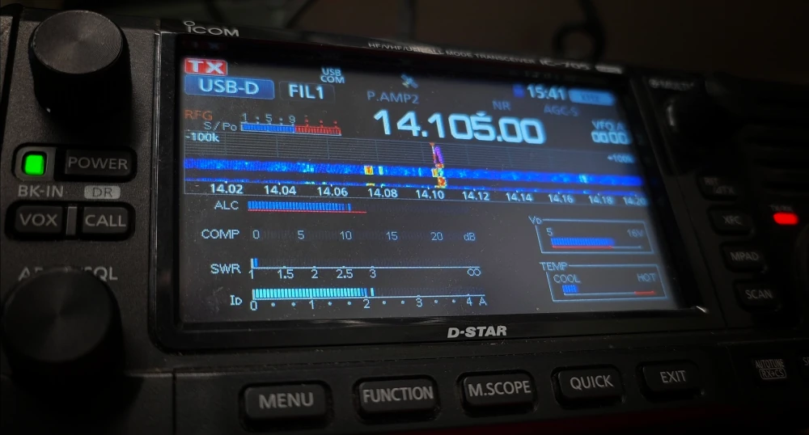

HamBros, an answer to pray hath arrived! A drop-in replacement for VARA on Linux! No more messing around with WINE or Bottles just to send an off grid email. Let's dive in to _xara_!

## 📥 INSTALLATION

My [last post on this topic](https://jrschultz.github.io/VE5REV/posts/Winlink/) was super complicated and convoluted. This is a xillion times simpler. We owe a lot to the absolute legend [x0rro](https://github.com/x0rro/xara) who made this project possible. This tutorial is set up on [Linux Mint](https://linuxmint.com/) 22.3 Zena. Get thee to the terminal!

### 🔄 Update the System

```bash
sudo apt update && sudo apt upgrade -y
```

### 📥 Install Dependencies

```bash
sudo apt install cargo-1.91 libpulse-dev libasound2-dev
```

### 📥 Install xara Modem

⚠️ **NOTE:** add ```--features registered``` if you have a registered version of VARA. Otherwise you can leave it out and use the following:

```bash
cargo-1.91 install --locked --force --git https://github.com/x0rro/xara xara
```

### ☎️ Dialout Group
 
For all things digital ham radio on linux, your user needs to be in the ```dialout``` group. This gives you access to serial ports and modems and such. On Debian/Ubuntu/Mint it is:

```bash
sudo adduser $USER dialout
``` 

Check [these notes](https://github.com/jrschultz/HamRef/blob/main/HR-Dialout.md) for other distributions. You can check if it worked by typing ```groups``` into the terminal. You might have to logout/login afterwards to make it take effect.

## ⚙️ CONFIGURATION

The configuration is quite minimal. You basically need a .conf file for xara with the optimal options:

```bash
cd ~/.config && nano xara.conf
```

Copy and Paste this configuration into that xara.conf file: 

```
call = ve5rev
hf = 2300
audio = alsa
capture = plughw:1,0
playback = plughw:1,0
radio
ptt = rigctld:127.0.0.1:4532
```

### 🛠️ Customize the Config File

✳️ You need to update it with **your callsign.**

✳️ You need to select the correct sound card audio for your system. To determine your capture/playback device(plughw), plug in your radio via USB and run the following in terminal:

```bash
arecord -l
```

This will show you your USB device such as Card 1 ... device 0.

✳️ This config assumes you are using rigctld for push to talk (ptt). There's actually many choices for this in the xara project notes. But this setup works really well.

## 💻 OPERATION

### 1️⃣ Start Rigctld

**rigctld** is a network daemon that's part of Hamlib, a library widely used in amateur radio software for controlling radios.

The following is specific for the Icom 705. I have [instructions](https://jrschultz.github.io/VE5REV/posts/Winlink/#rigctld) on how to set this up for other rigs as well as more details about what each piece of the command does. The radio is connected to the computer via USB.

```bash
rigctld -m 3085 -r /dev/ttyACM0 -s 38400 -T 127.0.0.1 -t 4532 &
```

⚠️ **NOTE:** You can also use FLRig instead of this. 

✳️ You can determine where your radio is on your system with this command: 

```bash
ls -l /dev/serial/by-id/
```

In my case, the IC705 is at ```/dev/ttyACM0```

Rigctld will run in the background, thanks to that final ```&``` at the end of the command.

### 2️⃣ Start xara

Now you can fire up the xara modem:

```bash
cd ~/.cargo/bin && ./xara --config ~/.config/xara.conf
```

This will continue to run in the terminal. 

### 3️⃣ Start pat winlink

Switch to a new terminal tab and run pat:

```bash
pat http
```

Using pat, choose VARA HF (xara listens on the same ports). Use pat as per normal to connect to a gateway.

## 🦾 AUTOMATION

I like to run each of these commands manually in their own terminal tab. Here's a handy way to keep them all close by. We can add a function to the shell to spit the commands out. Copy the following into your ```.bashrc``` or ```.zshrc``` file:

```bash
function xara-start() {
	echo "1-Start Rigctld: rigctld -m 3085 -r /dev/ttyACM0 -s 38400 -T 127.0.0.1 -t 4532 &"
	echo "2-Start xara: cd ~/.cargo/bin && ./xara --config ~/.config/xara.conf"
	echo "3-Start pat: pat http"
}
```

Then just ```source .zshrc``` to make it active. Now when you want to get this all running you can type ```xara-start``` in the terminal and the commands will display. Then you can copy and paste them into different terminal tabs.

## 😎 CONCLUSION

And that's it! With minimal configuring, you're up and running natively on Linux with a great replacement for VARA!



de VE5REV


