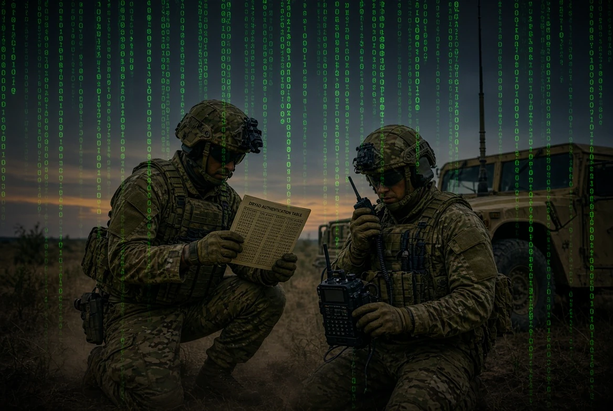
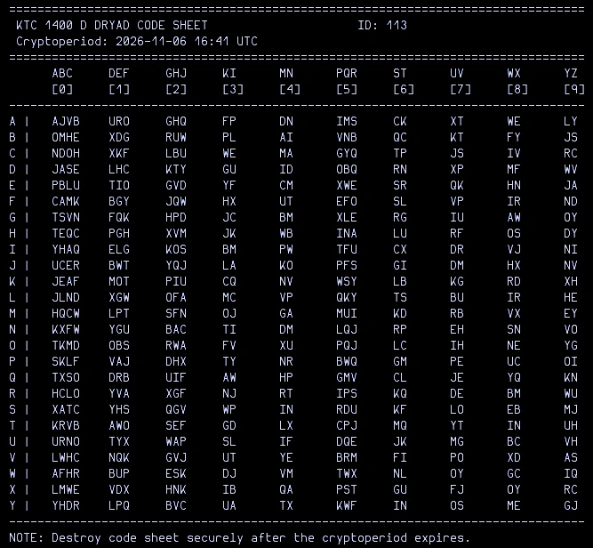
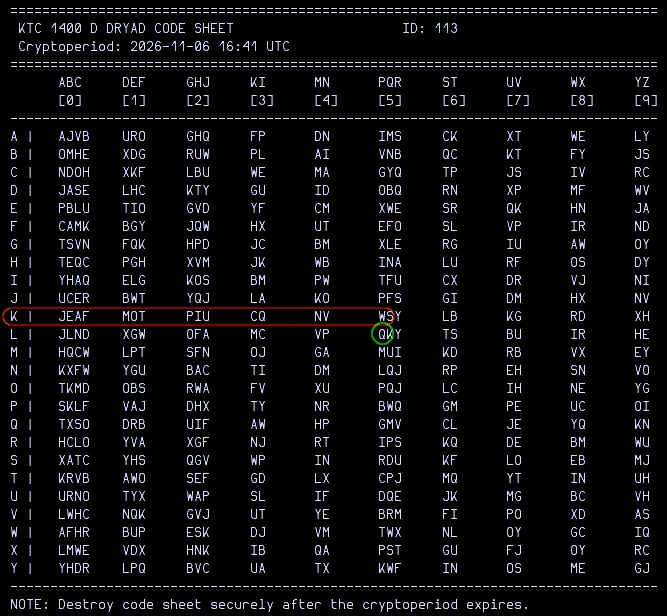
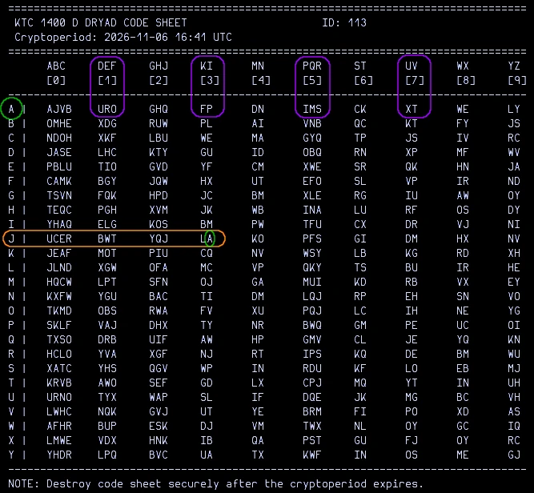

In my [previous post](https://jrschultz.github.io/VE5REV/posts/Auth/) on Authentication, I had generated simple authentication tables. This version generates the military KTC1400D table for the added feature of encrypting figures.

## 🗒️ KTC1400D DRYAD TABLE

The table is a low-tech, paper-based cryptographic system for tactical radio communications. Essentially, it is a [one-time pad](https://jrschultz.github.io/VE5REV/posts/JustOneTime/) that is on valid for a specific short duration known as a _cryptoperiod,_ typically around six hours. After this time, the current pad expires and a new table is used. Each row contains a randomized sequence of the letters A through Y distributed across the digit columns. Columns under frequently used digits (such as 0, 1, 2, and 5) contain multiple ciphertext options to frustrate frequency analysis.



## ⚙️ USAGE

✳️ **NOTE**: Everyone in the exercise has identical DRYAD tables and agrees on the **offset** (e.g., immediately below the intersection.)

### ✅ Authentication

🟢 **Authentication** allows a station to verify the identity of another operator over an unsecure radio channel before passing sensitive information.

🟢 **Initiating the Challenge:**

The challenging station selects a random row letter (e.g., "K") and a random letter from that row (e.g., "W") from the active DRYAD sheet.

🟢 **Transmitting the Challenge:**

The challenger transmits the challenge over the air (e.g., "Station Alpha, authenticate K-W")

🟢 **Finding the Response:**

The responding station looks at row K and identifies the specific letter "W" located at in that row. The letter **immediately below** this grid intersection is the challenge response. The operator then transmits it (Q) 'Quebec' back as the response.

🟢 **Verification:**

The challenging station checks the response against its own sheet. If the letters match, the identity of the station is verified.



#### ✅ Authentication Example:

🟢 Operator AAA: "BBB THIS IS AAA, AUTHENTICATE KW - OVER"

🟢 Operator BBB: "AAA THIS BBB, I AUTHENTICATE Q - OVER"

### 🔐 Encryption

🟡 **Encryption** is used to securely pass short numerical strings (like 6-figure or 8-figure grid coordinates).

🟡 **Selecting the Row and Set Letter:**

The coder chooses two random letters from A to Y. The first letter designates **the row** on the active page to be used for the message. The second letter is located in that row, and the adjacent letter **immediately to its right** is designated as the "**Set Letter**". The set letter is the row where the encryption will be done.

🟡 **Encoding Plaintext Digits:**

Numbers are encoded one digit at a time. For each plaintext digit, the coder looks at the chosen row and selects a ciphertext letter from the column matching that digit.

🟡 **Handling Repeats:**

If a digit appears more than once within the same number, the coder must choose a different letter option within that same digit's column to avoid pattern repetition. All digits for a single message are encoded using the same active row.   

🟡 **Transmission:**

The sender transmits the set indicator letters (row selector and set letter) followed by the string of ciphertext letters. The receiving station reverses the process using its matching sheet to extract the original numbers.



#### 🔐 Encryption Example:

🟡 Operator AAA: "BBB THIS IS AAA, SET JL. IUPOT - OVER"

🟡 The set line of JL is A. Alpha row is how we decode the numbers.

🟡 IUPOT = 51317

✳️ **NOTE:** The number 1 was encoded twice, using a different letter for the repeated number.


## 💻 THE SCRIPT

This shell script will generate the table. This script includes a random ID generator for the table as well.

Copy the code into a file. Rename the file ```KTC1400D.sh``` and make it executable: ```chmod +x KTC1400D.sh``` 

```bash
#!/usr/bin/env bash
#
# KTC 1400 D DRYAD Code Sheet Generator (with letter headers)

letters=(A B C D E F G H I J K L M N O P Q R S T U V W X Y)
row_labels=(A B C D E F G H I J K L M N O P Q R S T U V W X Y)

# Pure Bash Fisher-Yates shuffle (in-place)
shuffle() {
    local i j tmp n
    n=${#shuffled[@]}
    for ((i = n - 1; i > 0; i--)); do
        j=$((RANDOM % (i + 1)))
        tmp=${shuffled[i]}
        shuffled[i]=${shuffled[j]}
        shuffled[j]=$tmp
    done
}

echo "================================================================================="
echo " KTC 1400 D DRYAD CODE SHEET                     ID: $(printf "%03d" $((RANDOM % 1000))) "
echo " Cryptoperiod: $(date -u +'%Y-%m-%d %H:%M') UTC "
echo "================================================================================="

# Letter-group headers
printf "%-4s" " "
printf "  %-5s " "ABC" "DEF" "GHJ" "KI" "MN" "PQR" "ST" "UV" "WX" "YZ"
echo
# Column numbers
printf "%-4s" " "
for col in {0..9}; do
    printf "  %-5s " "[$col]"
done
echo
echo "---------------------------------------------------------------------------------"

for row in "${row_labels[@]}"; do
    shuffled=("${letters[@]}")
    shuffle

    printf "%-4s" "$row |"

    idx=0
    for col in {0..9}; do
        case $col in
            0)     count=4 ;;
            1|2|5) count=3 ;;
            *)     count=2 ;;
        esac

        col_letters=""
        for ((c = 0; c < count; c++)); do
            if (( idx < 25 )); then
                col_letters+="${shuffled[idx]}"
                idx=$((idx + 1))
            fi
        done

        printf "  %-5s " "$col_letters"
    done
    echo
done
echo "---------------------------------------------------------------------------------"
echo "NOTE: Destroy code sheet securely after the cryptoperiod expires."
```

You can dump the table into a text file for printing/sharing securely:

```bash
./KTC1400D.sh > DRYAD-01.txt
```

## ▶️ VIDEO RESOURCES

🔸[AmRRON](https://youtu.be/kSSM4qb1P8E)

🔸[Black Swan](https://youtu.be/sloV7O3L8SM)


73 de VE5REV


