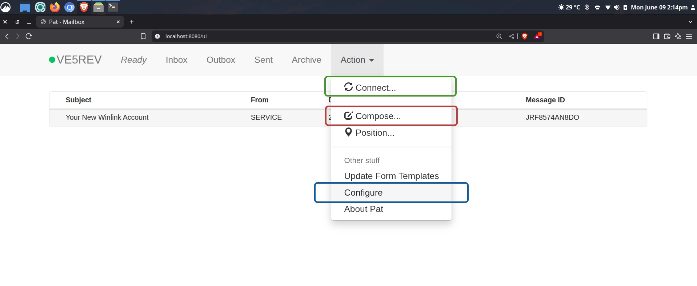
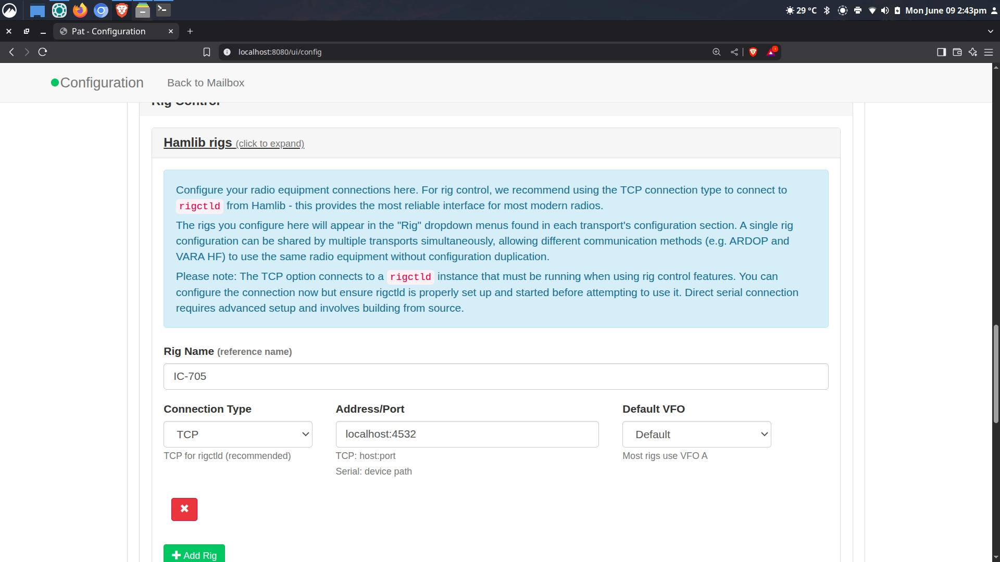
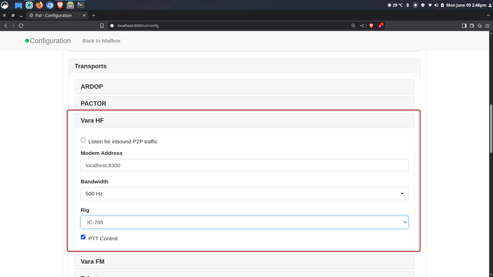
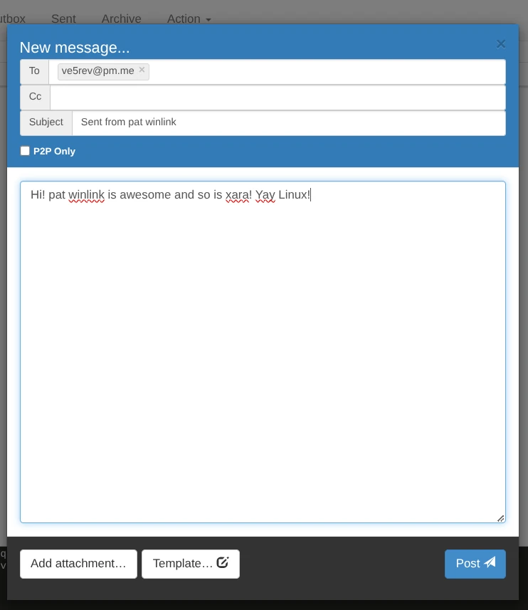
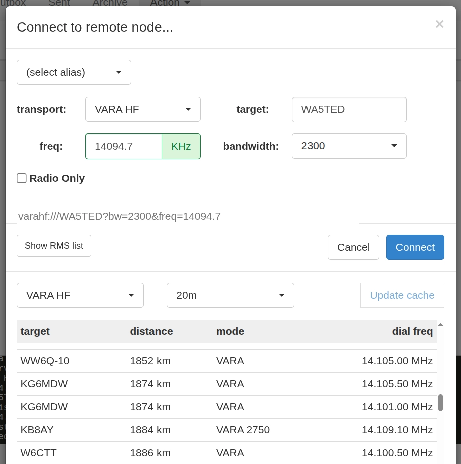
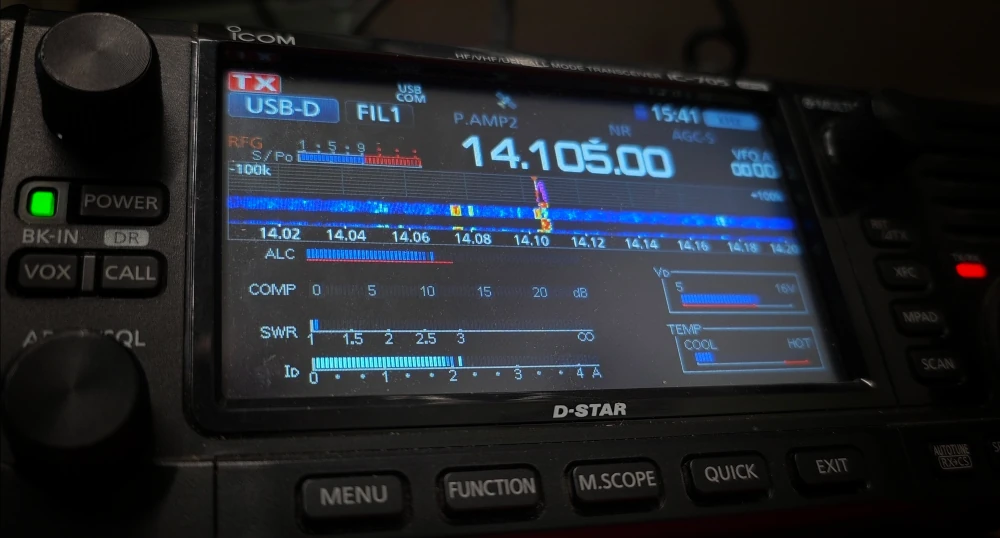

With the advent of [xara](https://github.com/x0rro/xara), a modern drop-in replacement for VARA, the world of winlink on Linux has changed forever. We can now get _comfy_ with winlink using xara and pat. This comfy guide is consolidated from my earlier posts:

✳️ [Winlink on Linux](https://jrschultz.github.io/VE5REV/posts/Winlink/)

✳️ [xara Modem](https://jrschultz.github.io/VE5REV/posts/Xara/)

## 📧 CONCEPT & CORE COMPONENTS

What we are doing is replicating the internet from the 1990s. We are pushing digital information over an analogue communication structure. This eventually morphed into the fully digital internet we all love today. However, we want to be able to do this with radio when we do not have internet connectivity.

### 🔊 Soundcard

A soundcard acts as a bridge, routing audio signals from the radio receiver into the computer so software can decode digital modes like FT8, JS8Call or Morse code. Conversely, it takes computer-generated audio tones and feeds them into the radio transmitter. Modern radios are increasingly being designed with built in sound cards as in the case of the Icom IC-705 (reference radio in this article).  There are awesome products available now such as [Digirig](https://digirig.net/) which give you this connectivity for virtually any radio. 

### 🐱 PTT and CAT

When the rig is connected to the computer we want two things to happen. We want it to **transmit** and we want it to **change frequency**. This is **PTT** _Push To Talk_ and **CAT** _Computer Aided Transceiver_. We are going to accomplish both with software.

### 📟 Modem

If you got to live through the internet of the 1990s, you'll no doubt remember the _modem_. It was a hardware device, with lots of blinking lights and crazy digital sounds to convert digital packets to analogue and sail over the telephone lines. The hardware has now been replaced with software and there are lots of options. However, we are interested in **xara,** a very fast modem which now runs natively on Linux with minimal configuration.

-----

## 🐧 LINUX SOFTWARE PACKAGES

There's a zillion different Linux distributions. This guide is centering on [Linux Mint](https://linuxmint.com/) which is highly regarded as being a user-friendly distribution. 

### 🔄 Update the System

This is always best practice: 

```bash
sudo apt update && sudo apt upgrade -y
```

### ☎️ Dialout Group
 
For all things digital ham radio on linux, your user needs to be in the ```dialout``` group. This gives you access to serial ports and modems and such. On Debian/Ubuntu/Mint it is:

```bash
sudo adduser $USER dialout
``` 

Check [these notes](https://github.com/jrschultz/HamRef/blob/main/HR-Dialout.md) for other distributions. You can check if it worked by typing ```groups``` into the terminal. You might have to logout/login afterwards to make it take effect.

### 😈 Rigctld install

The first thing we need to install is ```rigctld.``` This is the 'rig control daemon' - a background software program used to let computers control various radio transceivers. It is part of the open-source project ```hamlib.```

You can install from the terminal with:

```bash
sudo apt install libhamlib-utils
```

⚠️ **NOTE:** depending on your distribution, this might be different. This is for Linux Mint. You can search with your package manager for ```hamlib``` and see what comes up.

### 📟 xara install

[xara](https://github.com/x0rro/xara) will be our modem. It is fast and now runs natively on Linux. Do the following to get it installed:

📥 Install Dependencies

```bash
sudo apt install cargo-1.91 libpulse-dev libasound2-dev
```

📥 Install xara Modem

⚠️ **NOTE:** add ```--features registered``` if you have a registered version of VARA. Otherwise you can leave it out and use the following:

```bash
cargo-1.91 install --locked --force --git https://github.com/x0rro/xara xara
```

### 📮 pat Winlink install

The the winlink client we are using is ```pat```. (Aside: "Pat" is for some British kids' show with the "Postman Pat" character). [pat](https://getpat.io/) is cross platform for Linux, Mac and Windows which is fun. You can download the binaries from the [releases page](https://github.com/la5nta/pat/releases).

---

## ⚙️ CONFIGURATION

### 📟 xara config

The xara configuration is quite minimal. You basically need a .conf file for xara with the optimal options:

```bash
cd ~/.config && nano xara.conf
```

Copy and Paste this configuration into that xara.conf file: 

```
call = ve5rev
hf = 2300
audio = alsa
capture = plughw:1,0
playback = plughw:1,0
radio
ptt = rigctld:127.0.0.1:4532
```

#### 🛠️ Customize the Config File

✳️ You need to update it with **your callsign.**

✳️ You need to select the correct sound card audio for your system. To determine your capture/playback device(plughw), plug in your radio via USB and run the following in terminal:

```bash
arecord -l
```

This will show you your USB device such as Card 1 ... device 0.

✳️ This config assumes you are using rigctld for push to talk (ptt). There's actually many choices for this in the xara project notes. But this setup works really well. 
 
#### 📮 pat winlink config

If you’ve never used winklink before, you can use pat to get started. They will send you a password that you can use to log in to your winlink account on their website. Then you can change your password as you wish. To get pat to run, from terminal type ```pat http``` This will give us a nice web ui to play with instead of just running terminal commands (which you can do if you’d rather but this is nicer).

Then in your web browser of choice navigate to ```localhost:8080``` This will take you to the web ui. Before we use xara you can send an email using ```telnet``` (which is just regular internet). This will get you your password from the winlink network.



To do that, on the top right menu you will see the Action drop down menu. Click Compose… Write yourself an email to your normal email address. Then click post at the bottom of the email dialogue. This will pop the message into the outbox. Then go back to the Action drop down menu. Click Connect. On the top left click telnet. Leave everything default and click the connect button. You’ll get an email back with the subject ‘Your New Winlink Account’ which will have your winlink password you need for the configuration (which you should first change as mentioned above).

Now we can configure the pat winklink program. From that same Action menu click Configure. You go through configuration fields with your callsign, maidenhead locator, your changed password, etc. Then scroll down to Rig Control.

#### ⚙️ Hamlib Rigs



Here you punch in your rig info. Rig Name is just the nickname for your rig. You want TCP for Connection Type. You want ```localhost:4532``` for the Address/Port. That’s it! 

#### ⚙️ Transports 



Scroll back up to Transports. The nifty thing is that the xara modem listens on the exact same ports as VARA. So you can just select VARA HF. Pick your rig and make sure PTT is checked. You can change the bandwidth to 2300 to match our xara config file.

### 😈 Rigctld config

We need to tell ```rigctld``` what to do with this rather beastly command. It looks crazy but I've broken it down for you with an explanation:

```bash
rigctld -m 3085 -r /dev/ttyACM0 -s 38400 -T 127.0.0.1 -t 4532 &
```

🟣 ```-m``` specifies the model. 3085 is the Icom IC-705. You can search for your rig with ```rigctld -l | grep FT-891```. Grep will search the list for the radio you specify, in this example it's the Yaesu FT-891 with a model number of 1036.
```1036  Yaesu	FT-891	20230328.7 Stable RIG_MODEL_FT891```

🟣 ```-r``` specifies the place where your radio is connected to your computer system. To find this, disconnect the radio's USB cord from the computer. In terminal use the following commmands: ```dmesg -c``` to clear the log. Then run ```dmesg | grep -E "ttyUSB|ttyACM"``` This will show you where your radio is connected, in our case /dev/ttyACM0

⚠️ **NOTE:** the IC-705 actually has two connection points, but we want the first one with ```0``` at the end.

🟣 ```-s``` specifies the baud or the serial speed. The IC-705 will auto adjust to whatever you specify. I use 38400, but other have good luck with 9600. 

🟣 ```-T``` and ```-t``` specify the listening address port. ```-T 127.0.0.1``` is the loop back for the computer itself. We want ```rigctld``` to listen there on port 4532 which is the default

🟣 ```&``` this final ```&``` tells ```rigctld``` to run in the background.

-----

## 💻 OPERATION STEPS

Finally, let's put this all together! Close out everything you have open. Open the terminal.

### 1️⃣ 😈 Rigctld 

Start up ```rigctld``` with the following command in the terminal:

```bash
rigctld -m 3085 -r /dev/ttyACM0 -s 38400 -T 127.0.0.1 -t 4532 &
```


### 2️⃣ 📟 xara

Start up ```xara``` with the following:

```bash
cd ~/.cargo/bin && ./xara --config ~/.config/xara.conf
```

### 3️⃣ 📮 pat Winlink

Start up ```pat``` with the following:

```bash
pat http
```

Point your web browser to ```localhost:8080```

### 📩 Send an Email

Finally, at long last, we are ready to send an email over radio!

From the Action Menu click Compose... and write your email. When you're done, click post.



Then from the Action Menu, click Connect and select VARA HF. Click the Show RMS list too for a list of all the nodes you can connect to. What I did was select my band (20M) and then I browsed the list and recognized callsigns that I have worked before with CW. WA5TED showed up and I knew I was able to connect with him in Texas previously. I selected his node and all the settings will automagically populate in the pat window. I clicked Connect, the radio fired up and I was able to make the connection. 



This might be a bit of trial and error until you figure out which gateways you can reliably connect to on which bands.

## 🦾 AUTOMATION

I like to run all of these commands manually from the terminal. Here’s a handy way to keep them all close by. We can add a function to the shell to spit the commands out. Copy the following into your ```.bashrc``` or ```.zshrc``` file:

```bash
function xara-start() {
	echo "1-Start Rigctld: rigctld -m 3085 -r /dev/ttyACM0 -s 38400 -T 127.0.0.1 -t 4532 &"
	echo "2-Start xara: cd ~/.cargo/bin && ./xara --config ~/.config/xara.conf"
	echo "3-Start pat: pat http"
}
```

Then just source the file ```.zshrc``` to make it active. Now when you want to get this all running you can type ```xara-start``` in the terminal and the commands will display. Then you can copy and paste them into different terminal tabs to keep everything straight.

Stay Comfy! 😌



73 de VE5REV


